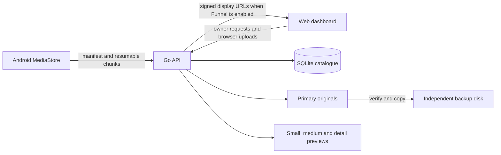

# Fotoro host

Fotoro's host is the source of truth for a personal media archive. It accepts originals from the Android app, browser or a local folder, keeps a SQLite catalogue, generates display copies and tracks an optional second disk. The host is a Go service on the owner's Linux machine; the [website](https://github.com/Fotoro/Fotoro-Server) and [Android app](https://github.com/Fotoro/Fotoro-Android) are clients.

## System boundary

The account service identifies the owner and stores the linked server endpoint. It does not hold the original media. Tailscale provides a network route; the Go API still verifies owner or paired-device credentials. Pairing issues a restricted device token, stored hashed on the host.

## Media lifecycle

1. A client asks which device assets are missing. Upload sessions record an expected size and SHA-256 digest, accept bounded chunks at explicit offsets and can resume after interruption.
2. The host verifies the completed bytes before committing an original under a content-derived path. A duplicate hash refers to an existing original. SQLite records capture time separately from import time.
3. Background work generates 256, 1024 and, where available, 2048 pixel display copies. The original remains unchanged. The timeline uses capture time, then import time if capture time is unavailable.
4. A separate backup target can receive and verify a second copy. `safe_to_delete` is advisory only: Fotoro never deletes source files on the phone.
5. The API lists metadata in pages. A browser shows small previews in a virtualized grid, larger display copies in the viewer and the original only when needed. Signed media URLs keep image bytes off the website relay when a configured Tailscale Funnel is available.

## Host state and reliability

SQLite in WAL mode holds the media catalogue, upload sessions, paired devices, queue, copy state and dashboard measurements. Originals and generated previews are files, not database blobs. The database and original files must both be included in a real recovery plan; a second media copy alone does not back up SQLite.

`fotoroctl` starts a user systemd socket on demand. The API wakes for requests and exits after ten idle minutes; no boot service is enabled by default. The storage and diagnostics APIs report primary availability, free space, backup state, pending work and database health. The server rejects a backup target that is the same filesystem as the primary or is not mounted as configured.

| Area | Principal code |
| --- | --- |
| HTTP, auth, pairing, metrics and media routes | `cmd/` |
| Catalogue, upload sessions, copies and previews | `internal/media/` |
| Schema and database connection | `internal/db/` |
| Capture metadata and image validation | `internal/validate/` |
| Desktop client | `desktop/` |

## Operational notes

The host is controlled with `./fotoroctl start`, `./fotoroctl stop` and `./fotoroctl status`. `./fotoro nodesync` refreshes the registered endpoint after an account or route change. `./fotoro fix-dates --dry-run` reports how many older timeline records can be repaired; `./fotoro fix-dates` applies the repair without rewriting originals. File modification time is only an approximation when embedded capture metadata is absent.

The optional model worker processes local analysis jobs. Search vectors and captions are derived data; the archive does not require them to preserve or serve originals. See [storage and retrieval design](STORAGE_RETRIEVAL_DESIGN.md) for display tiers and [the server runbook](SERVER_V1_RUNBOOK.md) for operator checks. This repository contains service code and local data paths; personal databases, library files and credentials are not release artifacts.
